# Forgetful research sprite


A public question goes in. Lookup is proxied through a Sprites connector. Notes stay on the Sprite. “Forget this.” wipes them and files a **deletion receipt** — not the notes.

**Kent G Lau, PhD.** No KYC. No retained PII. [MIT License](LICENSE).

## Live demo

**[hs26-forgetful-b4at6.sprites.app](https://hs26-forgetful-b4at6.sprites.app)**

- The Sprite is public. Its environment holds no provider keys.
- **Ask** and **Forget** on that URL need connectors granted in the Fly dashboard. They are not an end-to-end live run.
- Until those grants exist, the page shows the UI and a clean environment report.
- The checkable end-to-end run is local: `./scripts/e2e.sh --ci`, against `scripts/mock_gateway.py`.

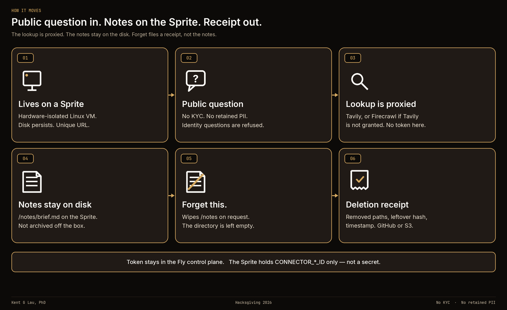

## Read it in one pass

<table>
<tr>
<td align="center" width="25%"><br><strong>Sprite</strong><br>The agent lives here</td>
<td align="center" width="25%"><br><strong>Question</strong><br>Public text only</td>
<td align="center" width="25%"><br><strong>Lookup</strong><br>Proxied, no token</td>
<td align="center" width="25%"><br><strong>Notes</strong><br><code>/notes/brief.md</code></td>
</tr>
<tr>
<td align="center"><br><strong>Forget</strong><br>Wipes <code>/notes</code></td>
<td align="center"><br><strong>Receipt</strong><br>Paths, hash, time</td>
<td align="center"><br><strong>Connector</strong><br>Key stays in Fly</td>
<td align="center"><br><strong>Mock</strong><br>Local fixtures</td>
</tr>
</table>

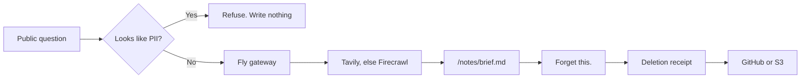

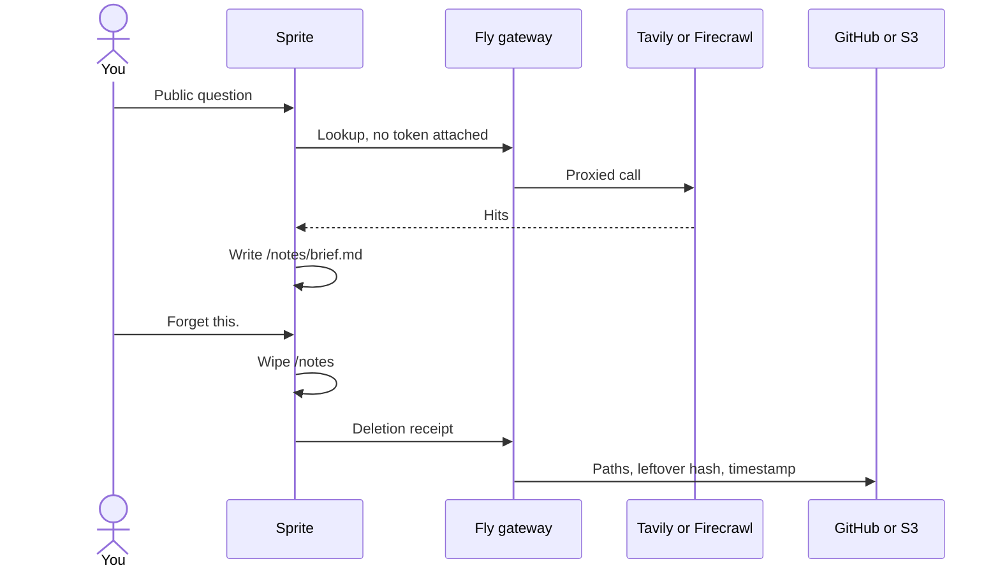

## Workflow poster

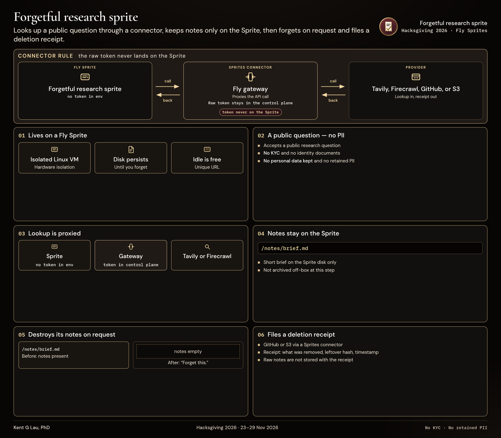

## Six panels

<table>
<tr>
<td width="33%"><a href="docs/diagrams/01-lives-on-a-fly-sprite.png">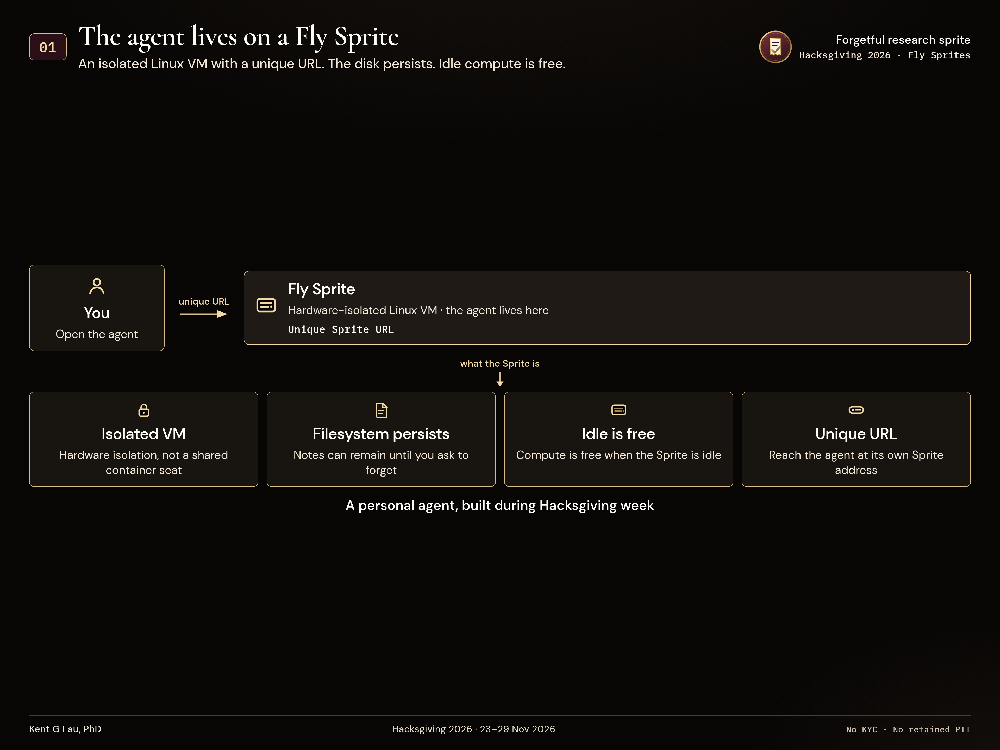</a></td>
<td width="33%"><a href="docs/diagrams/02-public-question-no-pii.png">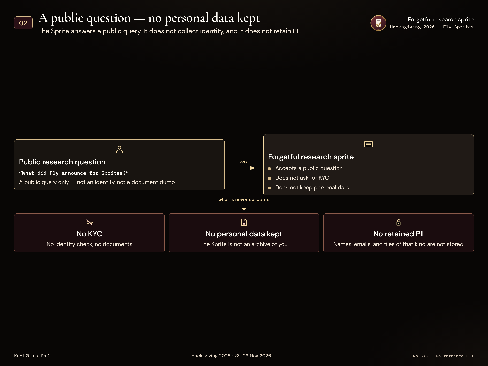</a></td>
<td width="33%"><a href="docs/diagrams/03-lookup-is-proxied.png">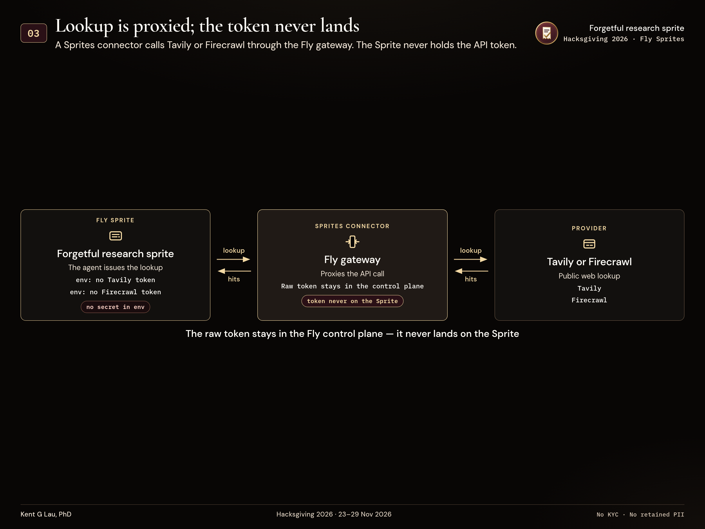</a></td>
</tr>
<tr>
<td><a href="docs/diagrams/04-notes-stay-on-the-sprite.png">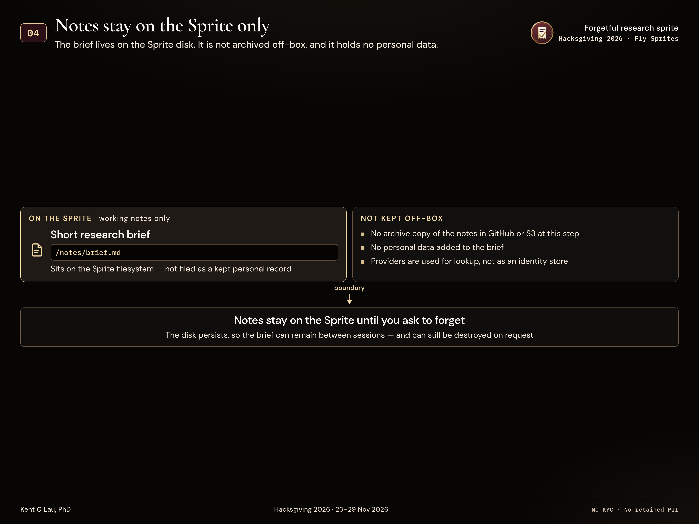</a></td>
<td><a href="docs/diagrams/05-destroys-notes-on-request.png">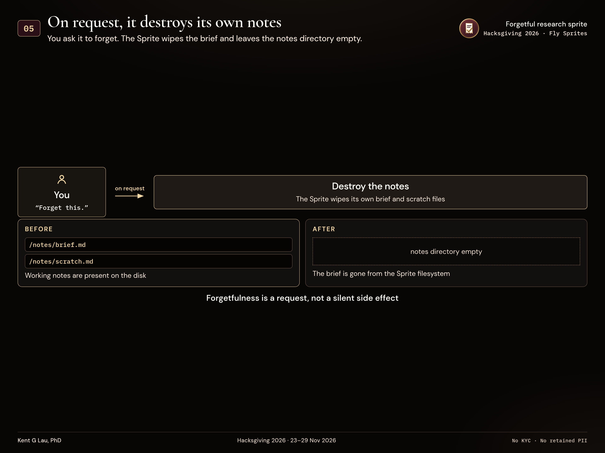</a></td>
<td><a href="docs/diagrams/06-deletion-receipt-filed.png">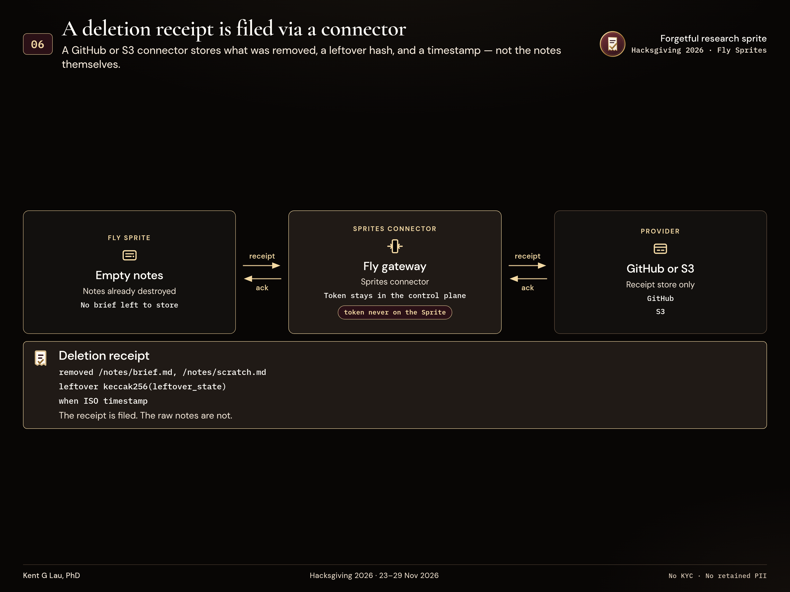</a></td>
</tr>
</table>

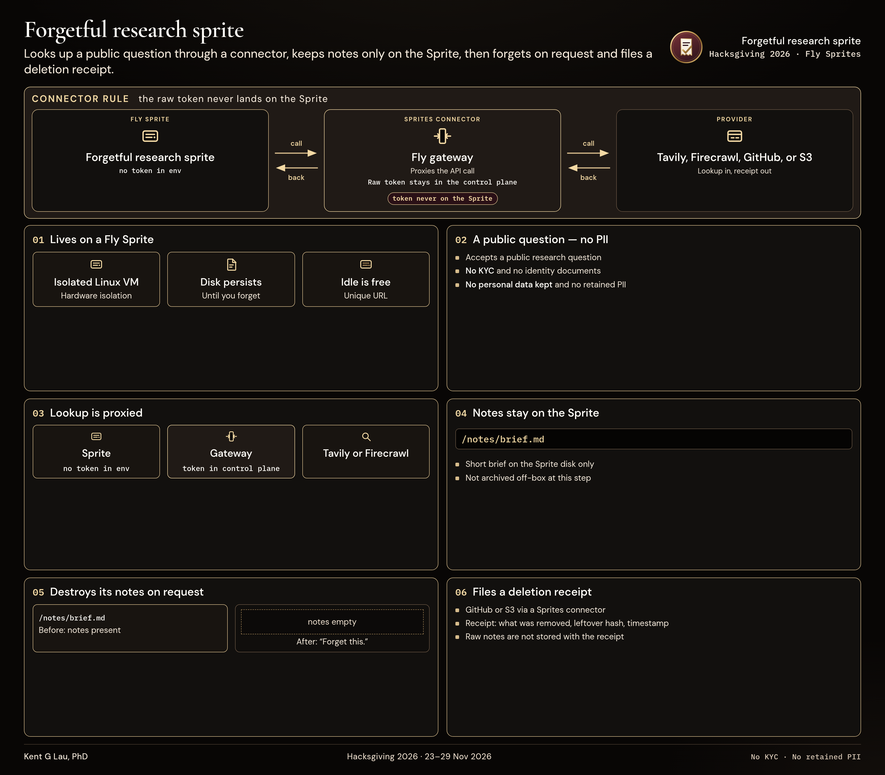

## What it does

### Lookup


- Accepts one public question. Email, phone, SSN-shaped numbers, card-shaped numbers, and KYC phrasing are refused. Nothing is written.
- Calls **Tavily** `search` through the Sprites gateway. If that connector is not granted, it calls **Firecrawl** `v1/search`.
- Writes a short brief to `/notes/brief.md` and a pointer to `/notes/scratch.md`.
- Refuses the brief too, if the lookup text itself looks like personal data.

### Notes


- The brief and the scratch pointer stay on the Sprite disk.
- They are not copied to GitHub or S3 at this step.
- On a Sprite, `SPRITE_ROOT=/` so those paths are `/notes/brief.md` and `/notes/scratch.md`.

### Forget


- Deletes the files under `/notes` and leaves the directory empty.
- Builds a receipt from the removed paths, a Keccak-256 leftover hash, and an `Asia/Hong_Kong` timestamp.
- Refuses to file the receipt if it would contain a line from the notes.

### Receipt


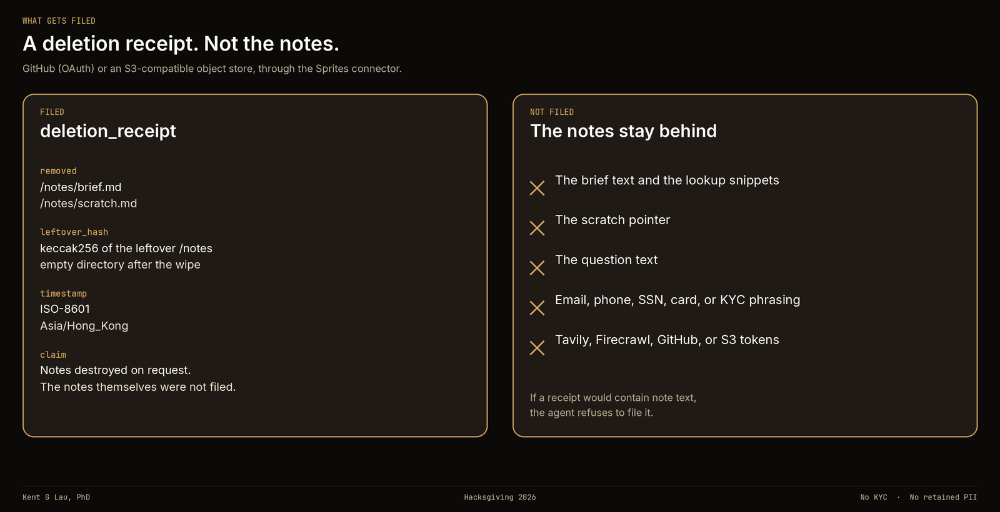

- `type` is `deletion_receipt`.
- `removed` lists `/notes/brief.md` and `/notes/scratch.md`.
- `leftover_hash` is Keccak-256 of the empty `/notes` directory, not of the brief.
- Filed with the **GitHub** connector (contents API) or, when `RECEIPT_STORE=s3`, with the **S3** connector.
- The stored object is the receipt. The notes are not in it.

## Connectors

Grant these in the Fly dashboard. Default-deny, then allow this Sprite by the name prefix `hs26-` or by a label.

| Job | Connector | Where the key lives |
| --- | --- | --- |
| Lookup, preferred | Tavily | Fly control plane. Bring your own key. |
| Lookup, fallback | Firecrawl | Fly control plane. Bring your own key. |
| Receipt | GitHub, OAuth | Fly control plane. Consent screen. |
| Receipt, alternate | S3-compatible object store | Fly control plane. Bring your own key. |

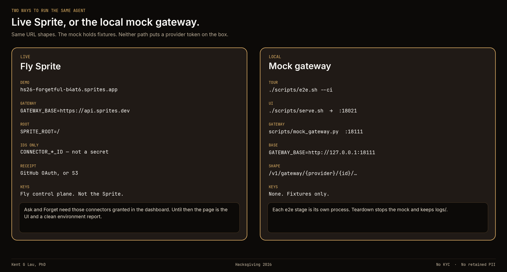

### What belongs in the environment

Ids and paths only. These are not secrets.

```bash
SPRITE_ROOT=/
GATEWAY_BASE=https://api.sprites.dev
CONNECTOR_TAVILY_ID=<id from the connector page>
CONNECTOR_FIRECRAWL_ID=<id>     # used when Tavily is not granted
CONNECTOR_GITHUB_ID=<id>        # default receipt store
CONNECTOR_S3_ID=<id>            # when RECEIPT_STORE=s3
RECEIPT_STORE=github            # or s3
RECEIPT_GITHUB_OWNER=<owner>
RECEIPT_GITHUB_REPO=<repo>
RECEIPT_S3_BUCKET=<bucket>
```

- Do not set `TAVILY_API_KEY`, `FIRECRAWL_API_KEY`, `GITHUB_TOKEN`, `GH_TOKEN`, `AWS_ACCESS_KEY_ID`, `AWS_SECRET_ACCESS_KEY`, or `S3_SECRET_ACCESS_KEY`.
- Do not put those values in this repo, in the Sprite env, or in logs.
- Ask and Forget refuse to run when a provider-secret name or a token-shaped value is present. `agent env` exits non-zero and prints the names, never the values.
- The gateway client refuses an `Authorization` header, an API-key header, and a token query parameter.
- The gateway authenticates the Sprite by platform identity.

## Local demo

- `scripts/mock_gateway.py` speaks the same paths as `https://api.sprites.dev`: `/v1/gateway/list` and `/v1/gateway/{provider}/{id}/…`.
- It stores fixtures and receipts only. It has no provider keys.

```bash
./scripts/e2e.sh            # menu: 1–8, or 9 to run all
./scripts/e2e.sh --ci       # every stage, teardown last
./scripts/e2e.sh --all      # same as --ci
./scripts/e2e.sh --stage 4  # one stage, in its own process
./scripts/serve.sh          # mock gateway on :18111, UI on http://127.0.0.1:18021/
```

- No arguments in a terminal opens the menu. A pipe, or any non-tty, runs every stage.
- One `scripts/e2e.sh` covers the project.
- Each stage is its own process, with its own pass/fail, timing, and log.
- A stage seeds a public brief when it needs notes, so `--stage N` passes on its own.
- Logs land in `logs/e2e-<UTC stamp>-<pid>/`: one `<stage>.log` per stage, plus `summary.log`.
- Teardown is stage 8, and it runs last. It stops the mock gateway and deletes the sprite root, the mock store, and scratch files. That run’s logs stay.

| Stage | Checks |
| --- | --- |
| 1 toolchain | Python, Keccak-256 vectors, PII patterns, connector ids are not secrets, gateway client refuses a token header and a token query |
| 2 env | Clean environment passes. A planted provider secret is refused and its value is not printed |
| 3 pii | An email-shaped question is refused. No file is written under `/notes` |
| 4 lookup | Tavily writes `/notes/brief.md`. A Tavily id that is not granted falls back to Firecrawl. The Tavily brief is what remains on disk |
| 5 notes | Brief and scratch stay on the Sprite, the brief has no PII, and the question is not in the mock store |
| 6 forget | `/notes/brief.md` and `/notes/scratch.md` are removed. The leftover hash matches the empty directory |
| 7 receipt | GitHub receives paths, empty-directory hash, and timestamp — not the notes. The same receipt is then filed through S3 |
| 8 teardown | Mock gateway stops. Work dirs are removed. Logs stay |

## On a Fly Sprite

1. Install the Sprites CLI. It is separate from `flyctl`.

   ```bash
   curl -fsSL https://sprites.dev/install.sh | sh
   sprite --version
   ```

   Or install the checksum-verified linux-amd64 binary from the [Sprites CLI installation docs](https://docs.fly.io/sprites/cli/installation).

2. Sign in with the Fly account `kentydotcom@gmail.com`.

   ```bash
   sprite login
   ```

   Approve the CLI in the browser. `sprite list` should then work. Creating Sprites stays on the Fly Free plan. Do not upsize a machine without asking.

3. Create one Sprite and select it.

   ```bash
   sprite create hs26-forgetful
   sprite use hs26-forgetful
   ```

4. In the Fly dashboard: organization **kentydotcom** → **Sprites** → **Connectors** → **Add connector**. Access is default-deny. Grant this Sprite by the name prefix `hs26-` or by a label.
   - GitHub OAuth opens a consent screen.
   - Tavily, Firecrawl, and S3 take the key in the **control plane**, not on the Sprite.

5. Copy this project onto the Sprite. Do not copy a `.env` full of secrets. Set `SPRITE_ROOT=/`, `GATEWAY_BASE=https://api.sprites.dev`, and the `CONNECTOR_*_ID` values from the connector page. Leave every provider token unset.

6. The default Sprite URL is authenticated. `sprite url update --auth public` only when the demo URL should be open. The live demo linked above is already public.

Until the grants exist, `./scripts/e2e.sh --ci` is the run that proves the path. The live page still shows the UI and a clean environment report.

## License

Copyright (c) 2026 Kent G Lau, PhD. [MIT License](LICENSE).

No KYC. No retained PII. Provider tokens stay in the Fly control plane. They are not written into this repository, a Sprite environment, or logs.

This tree has no provider keys, no Sprites or Fly tokens, and no Fe contest gate password.
